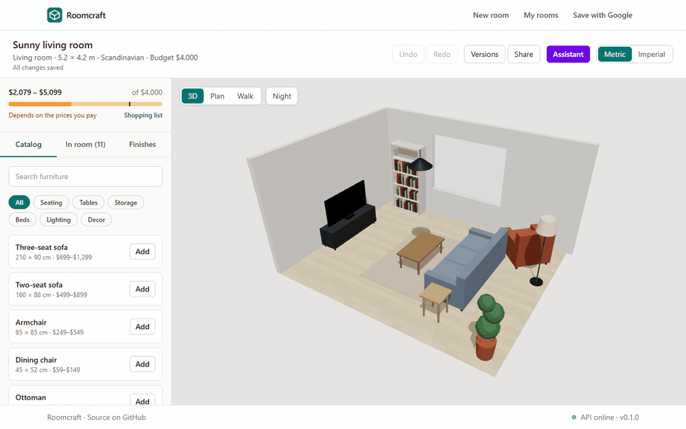
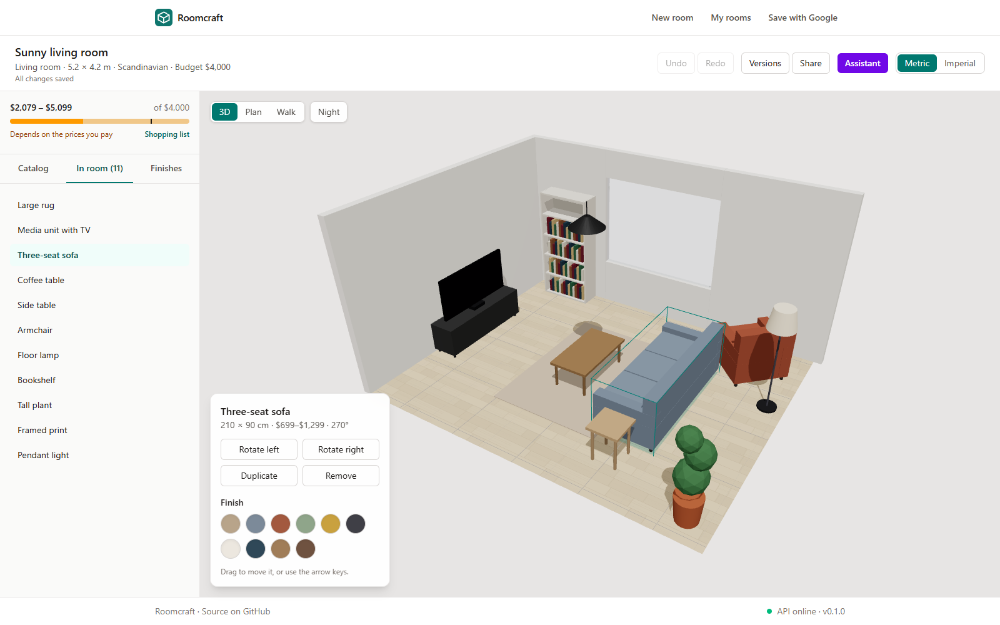
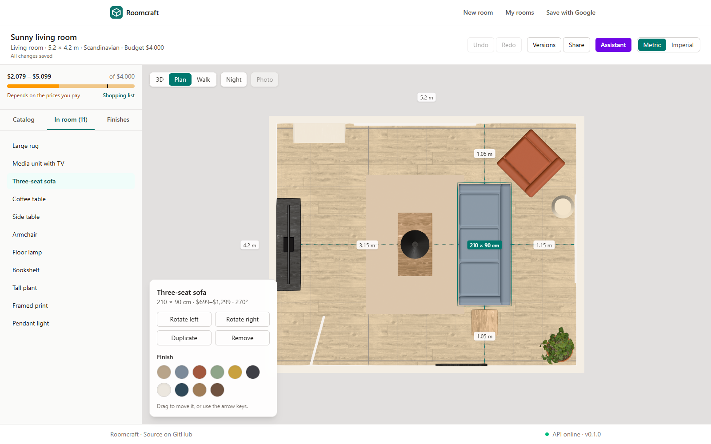
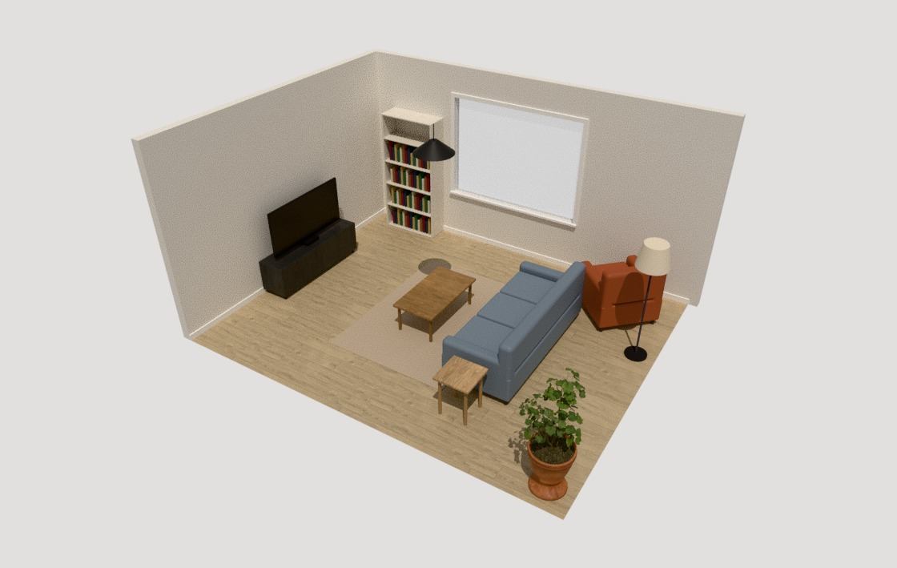
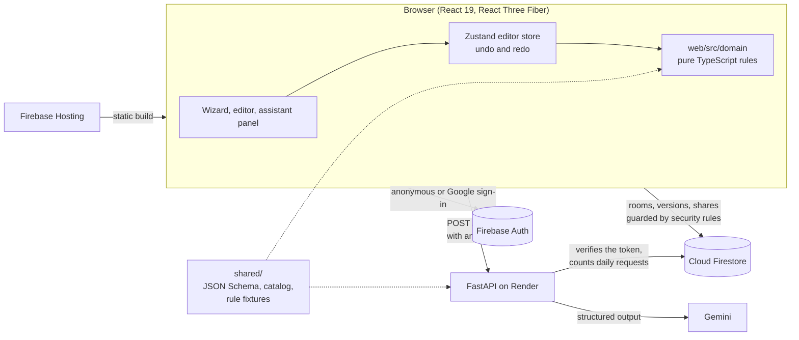

# Roomcraft

Roomcraft is a 3D room planner with a layout assistant that has to follow the rules. Describe a
room in a short wizard, furnish it with real-sized pieces, and ask for ideas like "a reading
corner under $400". The assistant answers with concrete changes that you preview in 3D before
anything moves, and the server refuses any change that would put a sofa through a wall, block a
door or break the budget. Plans save as you work, keep named versions, and can be shared as a
read-only link or a two-page PDF.

**Try it:** https://roomcraft-planner.web.app (no account needed: "Try the demo" opens a
furnished room) · **API docs:** https://roomcraft-api-929h.onrender.com/docs



## Features

- **Room wizard.** Room type, size (metric or imperial), doors and windows on any wall, style
  and budget, validated step by step with the same rules the API uses.
- **3D editor.** 26 pieces at real sizes: ten are real 3D models, the rest are built in code
  with rounded edges, soft cushions and throws. Vases, books and small plants dress the
  furniture, and curtains hang at the windows wherever furniture leaves room. Drag with snapping to a 10 cm grid and to walls, rotate
  in 15° steps, nudge with the arrow keys, undo and redo everything. Pieces cannot overlap or
  leave the room; rugs sit under furniture and art hangs on walls.
- **Finishes and light.** Wood, tile and carpet floors, plaster walls, and fabric and wood grain
  on the furniture, in any colour; skirting and window frames. Soft sun shadows, contact
  shadows where pieces meet the floor, and day and night with lamps as real light sources.
- **Photos.** One click path traces the current view in the browser, on the GPU, in 10 to 30
  seconds on a laptop, and the picture can be downloaded.
- **Ways to look.** Orbit with a dollhouse cut-away, a measured top-down plan, a first-person
  walk-through, and corner views at eye height, the way rooms are photographed.
- **Layout warnings.** Door swings that hit furniture and walkways narrower than 80 cm.
- **Layout assistant.** One suggestion or three options side by side with thumbnails, previewed
  in the scene and applied as a single undoable step. Refused changes are listed with the
  reason.
- **Budget.** A meter of the price range against the budget, a shopping list grouped by
  category, CSV export, and a PDF with a vector floor plan, a 3D snapshot and the list.
- **Saving and sharing.** Autosave, named versions with thumbnails, "My rooms", guest accounts
  that can be kept by signing in with Google, and share links that work without an account.
- **Everywhere.** Phones get a 3D viewer; keyboard and screen reader friendly; reduced motion
  respected; a short tour on the first visit.

| Editor                                                                            | Plan view                                          |
| --------------------------------------------------------------------------------- | -------------------------------------------------- |
|  |  |



## Architecture



| Path      | Contents                                                                                                                                 |
| --------- | ---------------------------------------------------------------------------------------------------------------------------------------- |
| `web/`    | React + TypeScript + Vite app. `src/domain/` holds the geometry and layout rules, with no React or three.js imports (enforced by ESLint) |
| `api/`    | FastAPI service (Python 3.12, uv): the layout assistant and its validation                                                               |
| `shared/` | Contracts used by both: JSON Schema with generated TypeScript types, the catalog, the demo room, and rule fixtures                       |
| `rules/`  | Tests for `firestore.rules` against the Firestore emulator                                                                               |
| `e2e/`    | The Playwright happy path, against the Firebase emulators                                                                                |
| `docs/`   | [Architecture decision records](docs/adr/)                                                                                               |

## How AI output is validated

The language model never edits a room. It returns a plan, and the plan has to earn its way in.

1. **Constrained output.** Gemini is called with a JSON schema for its answer: a short summary
   and a list of operations (`add`, `move`, `rotate`, `remove`, `material`). The prompt carries
   the room, the pieces already in it, the catalog with sizes and prices, and the rules.
2. **Strict types.** The model's schema is deliberately forgiving, so the server turns each
   operation into a strict Pydantic model. An `add` without a catalog id or a `move` without
   coordinates becomes a refused operation with the code `invalid_operation`, not an exception.
3. **Geometry, in order.** The operations are applied one by one to the room as changed by the
   ones before. Each must keep every piece inside the room, avoid overlaps on its layer, keep
   door swings clear and stay within the budget. Rotations snap to 15°, wall pieces snap onto
   the nearest wall and cannot be turned away from it. Anything that fails is
   reported with a code (`overlaps`, `blocks_door`, `over_budget`, ...) and the piece involved.
4. **One more try.** A plan with refused operations goes back to the model once, with what was
   refused and why. The new plan is checked the same way and replaces the first only if it is
   better. If it is slow or fails, the first answer still stands.
5. **Same rules on both sides.** The browser applies the accepted operations again with the
   TypeScript version of the same rules, against the room as it is now, before showing the
   preview. Both implementations run the same JSON fixtures (`shared/fixtures/*.json`) in their
   test suites, so they cannot drift apart silently.
6. **People decide.** A suggestion is a preview until it is applied, and then it is one undo
   step.

Requests need a Firebase ID token and are limited to 20 per person per day, counted in Firestore
so the limit survives the API restarting. If the primary model is rate limited, the API retries
with a lighter one.

## Key decisions and trade-offs

- **Firestore straight from the browser.** Rooms, versions and share links are read and written
  by the web app under security rules, not through a CRUD API. Editing keeps working while the
  free API instance sleeps, and the API only exists for what needs a server: the model key and
  validation of its output. The cost is a second place where data is validated, so the rules
  have their own test suite against the emulator.
- **Two implementations of the room rules.** The editor checks collisions and clearances on every
  drag movement, and the server cannot trust the browser, so the rules exist in TypeScript
  and in Python. Shared fixtures keep them identical; see
  [ADR-0002](docs/adr/0002-shared-schema.md) for the schema pipeline that does the same for types.
- **Pydantic as the single source of the contracts.** `pnpm schema` exports JSON Schema and
  generates TypeScript types; CI fails if either is stale.
- **Real models where they fit, shapes in code elsewhere.** Ten pieces and the decor are CC0
  models from Poly Haven; it has no modern sofas, beds or wardrobes, so those are built from
  rounded boxes and cylinders in code. A script turns each model's main colour texture grey, so
  any piece takes any colour, then simplifies and compresses it (3.2 MB for all of them; a room
  loads only its own). The live site serves the models from jsDelivr, pinned to a commit, to
  keep them off Firebase Hosting's daily download allowance; while one loads, or if it cannot,
  the piece shows its simple shapes. Light and surfaces do the rest: an environment map
  generated in code, soft shadows, ambient occlusion, sunlight through the largest window, and
  CC0 photo textures laid out in metres so they tile at real size.
- **Photos by path tracing.** The Photo button traces the current view with
  [three-gpu-pathtracer](https://github.com/gkjohnson/three-gpu-pathtracer), which loads only
  then (56 KB gzipped). The tracer needs plain geometry, so during a photo the instanced legs
  become separate meshes, the models' compressed vertices are floats, and a gradient sky stands
  in for the editor's environment map. It copies every texture into one array, at 512 px: at
  its default of 1024 a furnished room was several times slower. Its WebGL class is deprecated upstream in favour of
  WebGPU, so the version is pinned until the editor moves to WebGPU.
- **Snapshot history over pure functions.** Layout changes are pure functions returning new
  layouts, and undo keeps the snapshots. Simpler than a command log, and an assistant
  suggestion naturally becomes one step.
- **Share links are snapshots.** Publishing copies the room into a public document. The owner's
  project stays private, and visitors see exactly what was published.
- **Free hosting.** Firebase Spark and a free Render instance. Thumbnails are small WebP images
  stored in Firestore because new Spark projects cannot use Cloud Storage. The API sleeps after
  15 minutes and takes about a minute to wake; the app pings it on load and the assistant says
  it is waking up. See [ADR-0003](docs/adr/0003-api-hosting-on-render.md).
- **Small first load.** three.js, Firebase, jsPDF and the path tracer are loaded on demand, so
  the landing page ships none of them.

## Running locally

Requirements: Node 22, pnpm 10, and [uv](https://docs.astral.sh/uv/), which installs Python 3.12
for the API. The rules and end-to-end tests also need Java 21 for the Firestore emulator.

```sh
pnpm install
cp web/.env.example web/.env.local   # fill in your Firebase web app config
pnpm dev                             # web on :5173, API on :8000
```

The Vite dev server proxies `/api` to the local API, so CORS does not apply in development. Your
Firebase project needs Anonymous and Google sign-in enabled and the rules from `firestore.rules`.
The assistant needs a Gemini API key in `api/.env` (see [`api/.env.example`](api/.env.example));
without one, `POST /v1/assist` answers 503 and the rest of the app works as usual.

### Checks

```sh
pnpm check       # format, lint, typecheck, unit tests, build, API checks, schema drift
pnpm test:rules  # Firestore security rules, in the emulator
pnpm test:e2e    # the happy path in Chromium, against the Auth and Firestore emulators
pnpm api:docker  # the API image
```

CI runs all of them. The end-to-end test builds the web app in its `e2e` mode
([`web/.env.e2e`](web/.env.e2e)), which points Firebase at the emulators, so it never touches a
real project. Install its browser once with `pnpm --filter @roomcraft/e2e exec playwright install
chromium`.

## Deploying

Every push to `main` that passes CI deploys the web app to Firebase Hosting, and pull requests
get a preview channel. Render deploys the API from [`render.yaml`](render.yaml) once the same
commit's checks pass. Security rules are deployed by hand with
`firebase deploy --only firestore:rules`.

The API reads its secrets from Render: `ROOMCRAFT_GEMINI_API_KEY`, and a service account with
the Cloud Datastore User role as a secret file named by `GOOGLE_APPLICATION_CREDENTIALS`. The
web app's build-time config comes from GitHub Actions variables (`VITE_*`); none of it is
secret.

## License

Code: [MIT](LICENSE). The textures and the models are CC0 from
[Poly Haven](https://polyhaven.com); see the credits next to the
[textures](web/src/editor/surfaces/textures/README.md) and the
[models](web/public/models/README.md).
